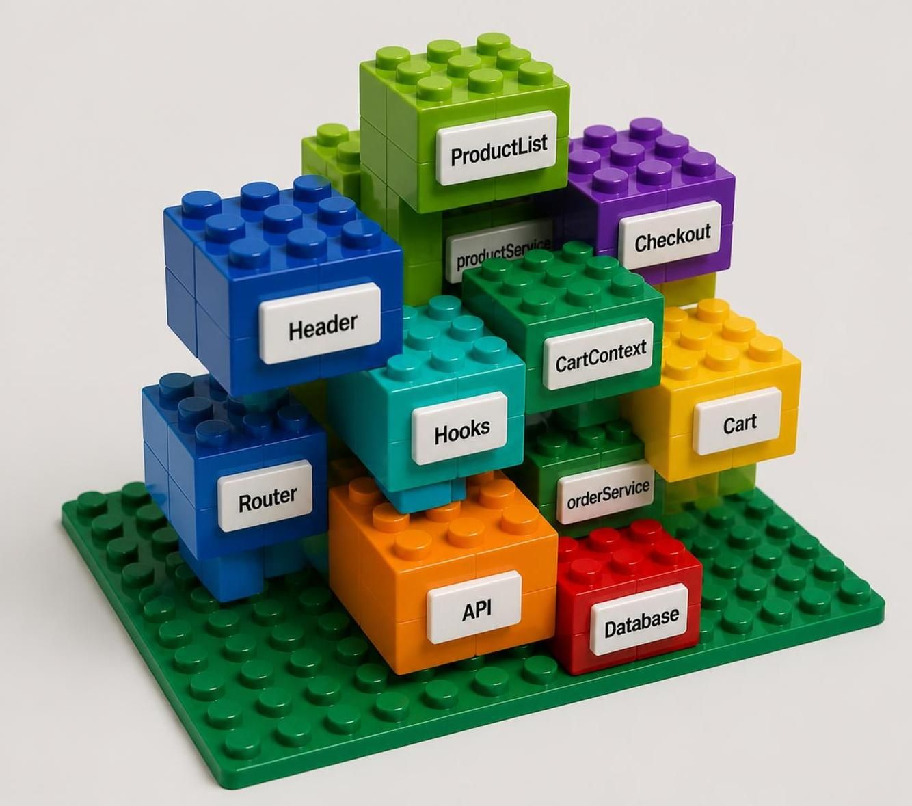
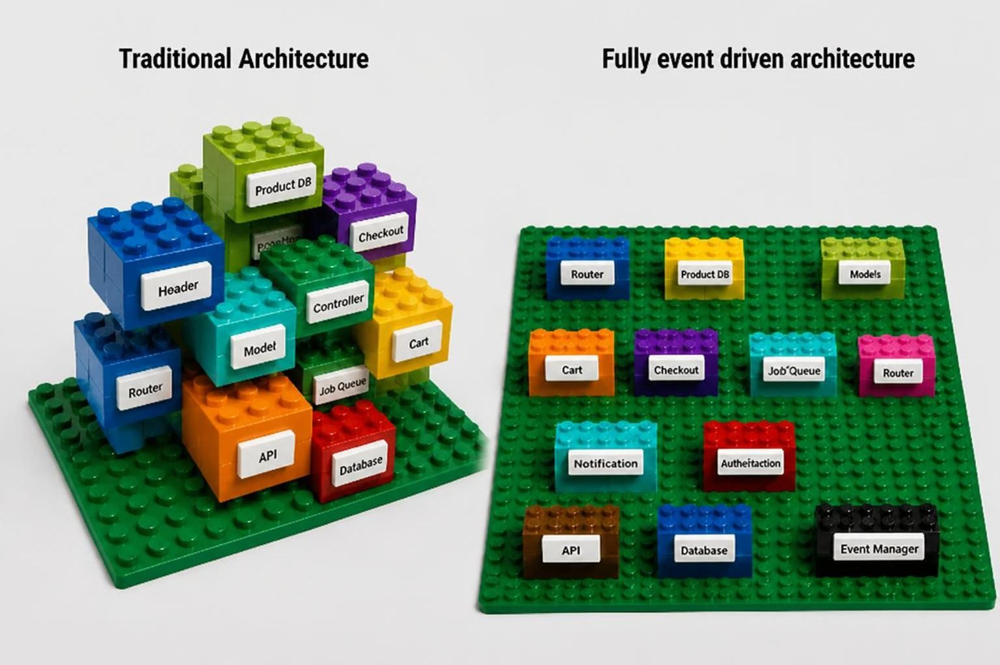

# From Traditional Architectures to Fully Event-Driven Systems: Why Architecture Matters for AI Coding Tools

*Note: This article was developed from the author’s ideas and refined with the assistance of AI.*

>Author’s note: I outlined the problem, added my own ideas and examples, and used an AI assistant to shape them into an article. I reviewed and refined the draft with the assistant, then asked it to write the conclusion.

AI coding tools can write and modify code, but working effectively in a large software project is still difficult. The challenge is not simply the amount of code. To make a correct change, a tool must also understand the system’s structure, the responsibilities of its components, and how those components communicate.

In a small application, a few files or functions may be enough to explain how a feature works. In a large system, one behavior may involve many modules. One component produces information, another transforms it, a third makes a decision, and yet another displays a result. These relationships may be direct and visible, or they may pass through layers, intermediaries, and undocumented conventions. As a result, a seemingly small change can affect parts of the system that are not obviously related to it.

>Traditional architecture(The left side): Modules may connect directly or use shared infrastructure. Because these relationships overlap, you may need to view the system from different angles to see them all.
>
>Fully event-driven architecture(The right side): Modules communicate through shared infrastructure by publishing and receiving events, without knowing about one another. The flatter layout makes the connections visible from a single view.

## Why AI Coding Tools Struggle with Large Projects

**It is difficult to see the whole system.** An AI tool may examine only part of a codebase, its documentation, or the files relevant to a task. Even when it can access a large repository, identifying every important relationship and understanding its significance is difficult. A module may depend on another component through several intermediaries, and that dependency may not be apparent from filenames or folder structure.

**Dependencies can be scattered and indirect.** In traditional architectures, modules may call one another directly, rely on one another’s data, or depend on one another’s internal details. As these connections multiply, it becomes harder to predict how a change in one component will affect the rest of the system. An AI tool may miss some of these relationships and generate code that conflicts with conventions the project relies on but does not clearly document.

**The tool has to make assumptions.** When a module’s role, inputs, outputs, or dependencies are unclear, the AI must fill in the gaps with its own interpretation. Those assumptions may sound reasonable but still differ from the intended design. The less explicit the architecture is, the more likely the tool is to rely on incorrect assumptions.

**Changes can become inconsistent.** An AI tool may update one component’s behavior without updating the other components that depend on it. In a large project, keeping related behavior consistent may depend on relationships that are not visible in a single file—or even a single folder.

**It can be hard to verify the result.** Generating code is not the same as confirming that a change is correct. The expected behavior, the components that should be affected, and the tests that should validate the change all need to be clear. If this information is implicit or buried in a complex structure, evaluating the AI’s output becomes more difficult.

## What “Fully Event-Driven” Means Here

The phrase *event-driven architecture* can describe many different designs, including systems that still use direct calls between components. This article uses the term **fully event-driven** in a stricter sense: components communicate through messages and events, rather than directly calling or retrieving information from one another.

A component publishes a message through shared event infrastructure. Other components can listen for messages relevant to them and decide how to respond. A publisher does not need to know which component will receive its message, and a receiver does not need to know which component published it.

This applies to communication within a feature as well as between larger modules. A component does not directly ask another component for a value and wait for a return. Instead, it publishes a request; a listener handles it; and, if a response is needed, that response is published separately. The original requester—or another interested component—can listen for the response.

Each component can still perform its own internal work. The rule is that it does not reach into another component or invoke that component directly. Communication across component boundaries happens through messages.

In this article, *event* is used broadly to include messages that request an action as well as messages that report something that has happened. In some software terminology, these are distinguished as commands and events. Whatever terms a project chooses, the message contracts and the distinction between requests and notifications should be clearly defined.

## A Dialog Example

Imagine an application with a toolbar, a dialog, a list, a text box, and a confirmation button. The purpose of the dialog is to collect a filename so the user can save something.

When the user clicks the toolbar button, the toolbar publishes a message indicating that the user initiated the save action. The toolbar does not need to know how saving works. A component responsible for opening the dialog listens for that message and opens it.

Inside the dialog, the list and text box communicate through messages. When the user selects an item in the list, the list publishes a selection event. The list does not need to know that a text box exists. The text box listens for the selection event and updates its own value.

When the user confirms the dialog, the dialog publishes a save event containing the filename the user entered. The component responsible for saving listens for that event and carries out the save. It does not need to know that a toolbar button opened the dialog, or how the filename was entered.

The button does not read the text box’s value. It simply signals the user’s confirmation. The dialog gathers the information it needs and publishes the resulting save event. The component that handles saving only needs to understand that event and its data.

This illustrates the separation of responsibilities:

- The toolbar reports the user’s action.
- A listener opens the dialog.
- The list and text box respond to relevant messages.
- The dialog publishes the save event with the filename.
- The saving component handles that event.

No component needs to know the identities or internal implementations of all the others. The toolbar does not need to know how saving works; the dialog does not need to know which component will save the file; and the saving component does not need to know where the filename came from.

## The Role of the Event Infrastructure

The event infrastructure is a neutral messenger. Its job is to route and deliver messages to the appropriate listeners. It does not understand the business meaning of a message, decide what a component should do, or perform the work requested by the message.

The responsibilities remain separate:

- The publisher decides when to publish a message and what information to include.
- The infrastructure routes and delivers the message.
- A listener decides whether the message is relevant, whether it is valid, and how to respond.

A response is not a direct return value from the listener to the publisher. If a component needs the result, that result is sent as another message and received by a listener. The component that initiated the original request does not have to handle the response unless it needs to.

## Structure and Communication Are Different

A visual or conceptual tree can describe where components belong. For example, it can show that a toolbar and a dialog are part of an application window, and that a list, text box, and button are inside the dialog.

That hierarchy describes placement and composition; it does not necessarily imply direct communication. A child component does not automatically need to call its parent, and a parent does not need to retrieve data directly from each child. Their interaction can still happen through messages.

This distinction matters because a tree is relatively easy to see, while communication paths can become complex. A fully event-driven design aims to make those paths explicit in the message contracts rather than embedding them in direct dependencies between components.

## Why Structured Event Contracts Can Help AI Tools

A fully event-driven architecture can be easier to explain to an AI tool when the boundaries and message contracts are documented explicitly. Those descriptions can be kept in structured files such as XML, YAML, or JSON.

For example, a project could document:

- What each component is responsible for.
- Which messages it publishes.
- Which messages it listens for.
- What information each message contains.
- Which responses may follow a request.
- Which component or components handle each message.

This gives an AI tool a clearer map of the intended architecture. Instead of inferring connections from scattered code, it can consult explicit descriptions of the components and their contracts. A task can then be framed in terms of a bounded change: add a listener for a particular message, publish a message under a defined condition, or update a component while preserving its existing contract.

Structured descriptions can also make review more focused. A developer can compare an AI-generated change with the documented responsibilities and message contracts: Did the change add an unintended direct dependency? Does the message contain the expected data? Are the relevant listeners and responses accounted for?

This does not guarantee that AI-generated code will be correct. The descriptions can be incomplete or out of date, and the implementation can still contain bugs. The architecture, contracts, tests, and code must agree. But when those pieces are explicit and maintained, the AI has fewer hidden relationships to guess at, and developers have clearer criteria for evaluating its changes.

## Event-Driven Design Does Not Remove Every Challenge

A fully event-driven architecture does not automatically make a system simple or error-free. If messages are poorly defined, component behavior is unclear, or message flows cannot be observed, it may be difficult to trace why something happened.

Messages can also be delayed, duplicated, or fail to arrive. A dependable system needs clear rules for message naming, data validation, delivery failures, repeated messages, and responses to requests. Developers also need ways to trace message flows and test how components behave together.

The goal is not to replace direct calls with messages without changing anything else. The goal is to define clear responsibilities and explicit communication contracts, so components can remain independent while the system’s overall behavior remains understandable.

## Conclusion

One of the main challenges AI tools face in large projects is understanding the many relationships—some hidden—between components. A fully event-driven architecture can reduce the need for those hidden relationships by requiring components to communicate through explicit messages rather than direct calls.

When components have clear responsibilities and message contracts, an AI tool can work with more clearly bounded units. Structured descriptions in XML, YAML, JSON, or other formats can make those boundaries and contracts easier to explain, inspect, and review. This can make AI-assisted changes more predictable, while still requiring tests, monitoring, and human review.

The benefit does not come from events alone. It comes from a consistent architecture: components that do not depend on one another’s identities or implementations, a neutral infrastructure that routes messages, and well-defined contracts that make the system’s behavior clear to both developers and AI tools.
