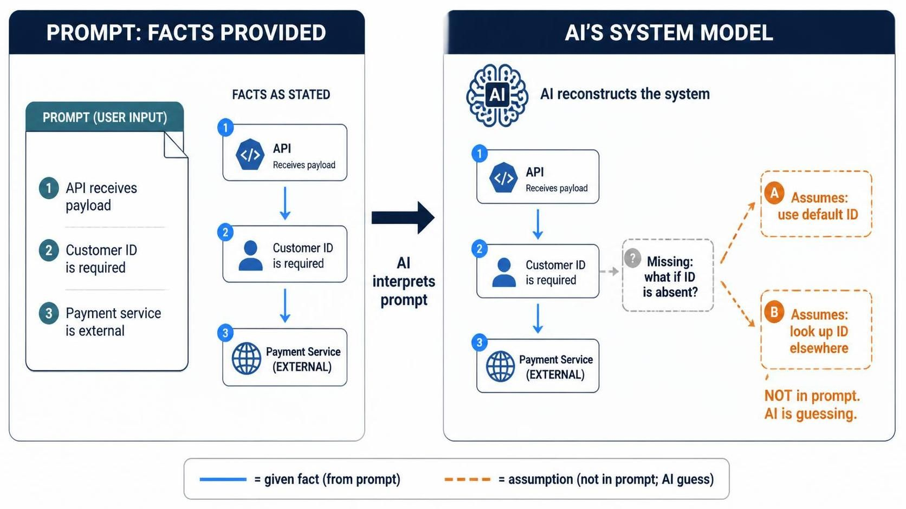

# Giving AI a Clear Picture of Your System: Prompts, Architecture, and Assumptions

*Note: This article was developed from the author’s ideas and refined with the assistance of AI.*

>Author’s note: I outlined the problem, added my own ideas and examples, and used an AI assistant to shape them into an article. I reviewed and refined the draft with the assistant, then asked it to write the conclusion.

AI coding tools can create useful software from a short request. For a small, new project, we might describe what we want and let the AI choose a structure, connect the parts, and write the code. Since it is designing much of the project itself, it can make assumptions that fit together.

That freedom is part of what makes AI useful. We don’t need to specify every detail ourselves. The challenge is knowing where the AI should use its judgment—and where it needs to follow facts about a system that already exists.

## Why a Short Request Can Work for a Small Project

Suppose we ask an AI tool to create a simple notes application. It can decide how notes are represented, how the interface saves them, and where they are stored. It invents a design and writes code around it.

This can work well for a small, new project because there are few existing constraints. The AI has room to make choices across the whole project, and it can keep those choices consistent. That does not mean its design is necessarily robust, secure, or the best possible one. It means the parts may fit together according to the system it imagined.

In an existing project, the AI has a different job. It must fit its work into an architecture it did not create. Its assumptions may conflict with decisions already made by the team.

## Assumptions Are Useful—Until They Conflict with Facts

AI’s ability to make assumptions is not simply a weakness. It is one of its strengths. If we had to specify every detail, rule, and implementation choice ourselves, we would be doing much of the work the AI is meant to help with.

An AI can fill in routine details, suggest an implementation, and explore possibilities we had not considered. It can help move from an incomplete idea toward a working design. The aim is not to eliminate assumptions. It is to balance the AI’s freedom to infer with the facts and constraints that must remain true.

For an existing system, the distinction matters:

- **Facts** describe the system as it is: its contracts, ownership, behavior, and constraints.
- **Open decisions** are areas where the AI may suggest options or make a reasonable choice.
- **Unknowns that affect compatibility or correctness** should be surfaced rather than silently decided.

For example, if an API receives a required customer ID in its request payload, that is a fact the AI should follow. If the code style for a new helper function is not specified, the AI can reasonably follow the project’s existing pattern or suggest one.

The goal is not to make every decision for the AI. It is to protect the important facts while leaving room for useful judgment.

## Existing Systems Have a Picture of Their Own

In an established system, components have responsibilities, services own particular data, and APIs and messages have contracts. Some dependencies are internal; others belong to external systems or teams.

A task may touch only one API or module, but that component still has a place in the larger system. If the AI cannot see that place, it will form its own picture. It might assume that one service can retrieve another service’s data, that a payload field is optional, or that a missing value should receive a default.

Those choices may be reasonable in a newly invented application, but they can be wrong in the system being changed. The code may even compile and pass basic tests while violating an existing contract.

## More Prompt Detail Does Not Always Mean More Clarity

It is tempting to solve this by adding more and more information to the prompt. But a long explanation can contain repetition, irrelevant details, outdated rules, or statements that appear to conflict. The problem is not length by itself; it is whether the information is clear, relevant, and consistent.

An image-making example illustrates the point. If we describe a system with many overlapping details, an image-generation tool may produce a result that misses the overall structure. A shorter description focused on the main relationships may make the intended image clearer. On the other hand, leaving out essential relationships may cause the tool to invent them.

Coding tools face a related challenge. More context is helpful when it grounds the AI in the real system. It is harmful when it obscures which facts matter or which source should be trusted.

The aim is not to explain everything. It is to provide the right information at the right level, and make clear where the AI is free to use its judgment.

## A Clear Architecture Makes the System Easier to Explain

A prompt can help the AI, but it cannot always compensate for an architecture whose responsibilities and connections are hard to describe. If understanding one component requires piecing together hidden dependencies, informal conventions, and exceptions across many places, the AI—and often a person—may struggle to form an accurate picture.

An architecture that is easier to explain makes important facts visible:

- What each component owns, and what it does not own.
- How components communicate, and through which contracts.
- Which systems are internal and which are external.
- Where data comes from and which component is responsible for it.
- What rules apply at service boundaries.

This does not mean every system should be simple internally, or that a design should be chosen only because it is easy for AI to describe. Some systems need complex architecture. The goal is to make their important boundaries and relationships understandable, not to pretend that the complexity does not exist.

## Give the AI a Map and the Relevant Rules

A system diagram can give the AI a compact map: which components belong to the system, which services are external, and where communication crosses boundaries. For a particular task, the AI also needs the contracts and rules that govern the relevant component.

For example, a task might need the diagram showing the service and its immediate dependencies, the API or message contract it follows, and tests showing expected behavior. The diagram provides orientation; contracts and tests explain what the connections mean.

The prompt can point to those sources and focus the task:

> Add validation to the order request handler. The request schema is the source of truth for required fields. Preserve the existing response format. Do not fetch missing values from another service or add defaults. If you find an unresolved behavior, report it before implementing it.

This does not dictate every coding choice. It protects the known system facts while leaving the AI room to decide how best to implement the change.

## Make Uncertainty Visible

When something important is not specified, the AI should not have to disguise a guess as a fact. The prompt can say which decisions are open and invite the AI to propose options. For example:

> The handling of duplicate notifications is not defined in the current contract. Identify the likely options and their trade-offs before choosing an implementation.

This lets the AI use its ability to reason and suggest, without confusing an unapproved decision with an existing system rule. For less consequential details, it can make a reasonable assumption and state it.

A useful workflow is to ask the AI to summarize the component’s role, dependencies, known constraints, and open questions before it changes code. If the summary is wrong, correct its picture first. If it is right, the AI can proceed with more confidence.

## Explainability Helps People Too

Making an architecture easier to explain is valuable beyond AI-assisted coding. It helps developers understand ownership, find relevant contracts, review changes, and onboard to a system. AI makes the benefit more visible because it has to work from the information it can access—but the same clarity helps the whole team.

This does not mean choosing an architecture that is simple at any cost. Nor does it mean replacing one style, such as direct APIs, with another, such as event-driven communication, just because one seems easier to describe. Each approach has trade-offs. What matters is that the responsibilities and communication rules are explicit enough to understand and maintain.

## Conclusion

AI is useful partly because it can work beyond the facts we provide. It can infer, propose, and fill gaps—that is a source of its power, not merely a risk. The challenge is to let it make helpful assumptions without letting those assumptions silently override the real system.

A clear architecture gives the AI a reliable picture of the system’s important boundaries and contracts. A focused prompt supplies the context needed for a particular task, distinguishes established facts from open decisions, and leaves room for the AI to contribute. The goal is not to specify everything in advance. It is to make the system clear enough that the AI can use its judgment where it helps—and recognize where it needs to ask, propose, or defer.